 

<a href="mailto:harsha210108@gmail.com"><code>harsha210108@gmail.com</code></a>
&nbsp;&nbsp;·&nbsp;&nbsp;
<a href="https://linkedin.com/in/harsha-n-2a267038a"><code>linkedin</code></a>
&nbsp;&nbsp;·&nbsp;&nbsp;
<a href="https://github.com/harshaxyZ?tab=repositories"><code>all repositories</code></a>

  

